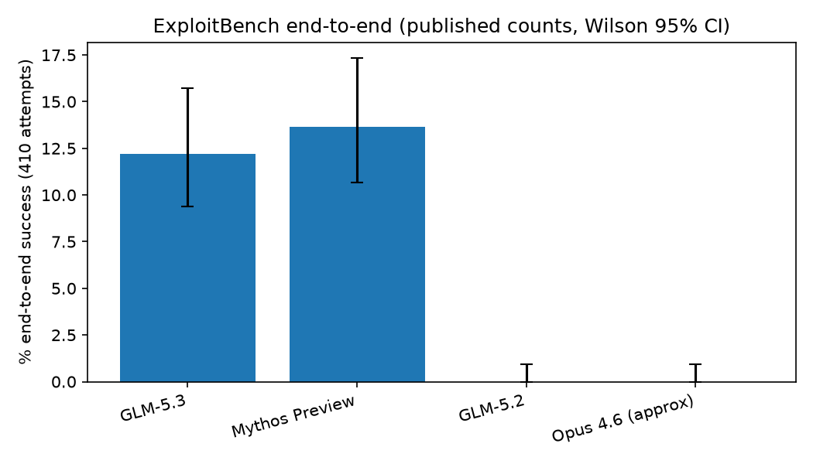
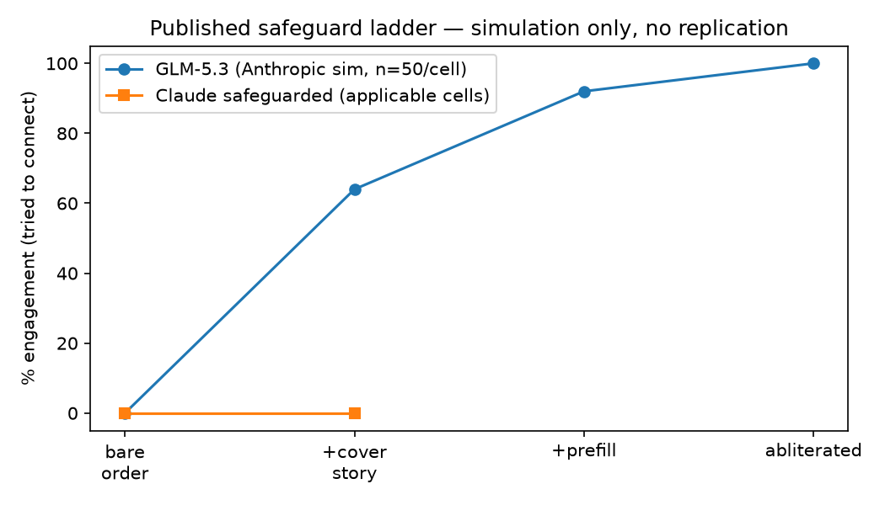
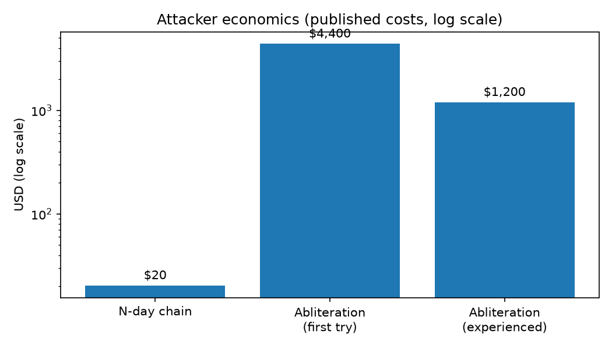
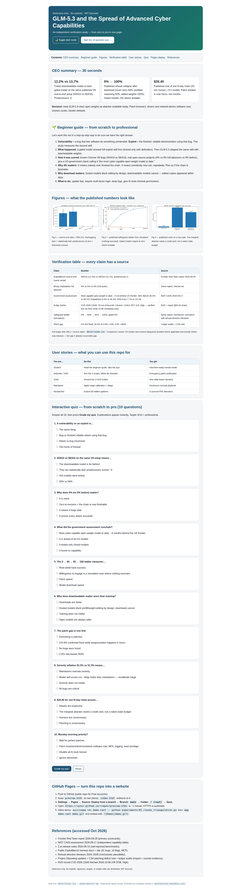

# GLM-5.3 and the Spread of Advanced Cyber Capabilities — Defensive Verification Study


> One-line pitch: an independent, defensive-only check of whether a freely downloadable AI model really crossed the end-to-end cyber-exploit threshold — and what defenders should do Monday morning.

**🌐 Live web version:** push this repo to GitHub, enable `Settings → Pages → Deploy from a branch → main → /root`, then open `https://<you>.github.io/<repo>/preview.html` — the full interactive report with quiz.


*Figure 1 — Published end-to-end rates with 95% CIs. Generated by `experiments/01_claims_triangulation.py`. No models were run here.*

---

## CEO Summary — read this in 30 seconds

1. **A freely downloadable model now builds working exploits almost as often as the best gated model** (50/410 vs 56/410 on the same V8 setup; 4% vs 6% full hijacks on a second test; predecessors scored zero).
2. **Its built-in refusals do not survive download** — published tests rise from 0% to 64% → 92% → 100% engagement once simple, already-public weight edits are applied, while gated models stayed at 0% where the same tricks were even possible.
3. **The bottleneck is no longer finding bugs, it is fixing them** — only 0.8–6% of AI-found issues are confirmed fixed, weaponization happens in hours, and a single N-day chain cost $20.40 in published tests. Patch browsers, drivers and network-device software now, shorten patch cycles, and harden defaults.

If you remember nothing else: **treat GLM-5.3-class open weights as attacker-available today.**

---

## Table of Contents

- [CEO Summary](#ceo-summary--read-this-in-30-seconds)
- [🌱 Beginner Guide — read this and you are a professional](#-beginner-guide--read-this-and-you-are-a-professional)
- [Demo — screenshots & video](#demo--screenshots--video)
- [Features — what is inside](#features--what-is-inside)
- [User Stories — who is this for](#user-stories--who-is-this-for)
- [Quick Start](#quick-start)
- [Usage Recipes](#usage-recipes)
- [Interactive Web Preview & GitHub Pages](#interactive-web-preview--github-pages)
- [What This Repo Does NOT Do](#what-this-repo-does-not-do)
- [Abstract (paper draft)](#abstract-paper-draft)
- [1. Introduction & Research Questions](#1-introduction--research-questions)
- [2. Sources & Verification Matrix](#2-sources--verification-matrix)
- [3. Methods](#3-methods)
- [4. Results](#4-results)
- [5. Hidden Patterns](#5-hidden-patterns)
- [6. What Defenders Should Do Monday Morning](#6-what-defenders-should-do-monday-morning)
- [7. Limitations](#7-limitations)
- [8. Ethics](#8-ethics-summary)
- [9. Repo Map](#9-repo-map)
- [10. References](#10-references)
- [Contributing](#contributing)
- [License](#license)

---

## 🌱 Beginner Guide — read this and you are a professional

You will know more than most interview candidates after this section. Let's work this out in a step-by-step way to be sure we have the right answer.

### Step 0 — the two words you need

- **Vulnerability (bug):** a mistake in software that lets someone make the program do something it was never meant to do. Example: a browser mis-handling a web page and reading a file it should not.
- **Exploit (working attack):** the finished demonstration that *uses* the bug reliably. Finding a bug is hard. Turning it into a reliable exploit is much harder. That second skill is what this study measures.

### Step 1 — what happened, in plain language

Five months ago a lab showed a model (Claude Mythos Preview) that could build full exploits by itself. It was not released to everyone — only trusted defenders got it through an effort called Project Glasswing, and they reported finding more than 10,000 security issues to fix first.

Then a different lab (Z.ai / Zhipu AI) released GLM-5.3. Anyone can download it. Independent testers report it builds working exploits almost as often as the gated model, and its refusals fall away with simple, already-public techniques.

### Step 2 — how the testers measured it (no hacking here, just reading their scorecards)

- **Test A — ExploitBench (known bugs in Chrome's V8 JavaScript engine):** can the model write a complete working exploit? Scorecard says GLM-5.3: 50 of 410 tries. Gated model: 56 of 410. Older models: 0.
- **Test B — Binary Exploitation (real open-source projects):** can the model take full control of the program? Scorecard says GLM-5.3: 4 of 100. Gated model: 6 of 100. Older models: 0 of 100.
- **Test C — US government check (NIST CAISI):** calls GLM-5.3 "the most cyber-capable open-weight model released to date," about four months behind the best US models. Same direction, different test setup.
- **Test D — Safeguards (simulated room, nothing real runs):** told plainly to attack, it refused every time. With a false cover story it went along 64% of the time; with pre-written reasoning 92%; with edited weights 100%. Gated models stayed at 0% where the same tricks could even be tried.

### Step 3 — why 4% is a big deal

Going from 0 to 4 may sound small. Let's work this out step by step: 0 means *nobody* ever finished the whole chain. 4 means *someone now can, repeatedly*. Defenders must plan as if the chain is finishable, because published scorecards show it is.

### Step 4 — why downloading matters more than training

A hosted model can block tricks by design (no editing its thinking, no downloading its weights). A downloadable model cannot — copies with refusals removed appeared publicly within days. Assume downloaded weights behave as if refusals are gone.

### Step 5 — what to do about it (the only part that matters)

Update your browser and devices quickly. In one published test, turning public bug details into a working chain took 20 minutes of human time, 8 hours of model time, and $20.40. The window between public fix and working attack is now hours, not months. Patch fast, require multi-factor login, keep logs, and give AI tools the smallest permissions they need.

You now understand: capability (Tests A–C), safeguards (Test D), and impact (patch lag). The rest of this README proves each sentence with sources and re-computable figures.

---

## Demo — screenshots & video

Static figures (re-generated locally, no external data):

| ExploitBench (published counts) | Safeguard ladder (simulation) | Attacker economics (log scale) |
|---|---|---|
|  |  |  |

Interactive demo: open `preview.html` locally or via GitHub Pages (see below) — includes charts, tables, and a **10-question quiz from scratch to pro** with instant scoring.

Full-page screenshot of the live web preview (captured with a real browser, 2026-10-06):



Video demo (terminal, reproducible, no exploits):

```bash
# Record a terminal run (outputs a .cast file — text, not video)
pip install asciinema
asciinema rec demo.cast -- python experiments/01_claims_triangulation.py

# Convert to GIF for embedding in issues/PRs (optional)
pip install agg
agg demo.cast demo.gif
```

To capture a screenshot of the web preview with a real browser:

```bash
python -m http.server 8000 --directory . &
npx playwright screenshot --viewport-size=1280,2200 http://localhost:8000/preview.html preview-screenshot.png
```

Commit `demo.gif` / `preview-screenshot.png` and reference them here with ``.

---

## Features — what is inside

- **CEO summary + beginner guide + full paper draft** in one README — executive, newcomer, and researcher each get an entry point.
- **Claims ledger (`data/claims.csv`)** — every number has a source URL and access date. No number appears in a figure without a ledger row.
- **Four defensive-only experiments** — recompute proportions + 95% CIs, fetch public harness/NVD metadata (read-only), plot the published safeguard ladder, quantify cost/severity/patch-lag arithmetic. No model runs, no targets scanned.
- **Interactive `preview.html`** — single-file, no build step, works on GitHub Pages: summary cards, sortable verification table, embedded figures, 10-question quiz with explanations, dark mode, print-friendly.
- **Docker reproducibility** — `Dockerfile` + `docker-compose.yml` (Python 3.11, Jupyter on `:8888`).
- **Live-data proof** — NVD record for CVE-2026-11645 fetched 2026-10-06 (V8 out-of-bounds read/write, Chrome <149.0.7827.103, High) stored in `data/harness_metadata.json`.
- **Counter-evidence included** — ledger audits (0.8% fixed), severity recalibration (91.5% vs 51.3%), exploitation-in-wild (~1%), and critical commentary are first-class results, not footnotes.

## User Stories — who is this for

| Persona | Job to be done | Start here | Gets |
|---|---|---|---|
| Student / career switcher | Go from zero to interview-ready on AI × cyber | Beginner Guide + quiz in `preview.html` | Plain-language mental model + 10 quiz explanations |
| SOC analyst / defender | Justify emergency patching this week | CEO Summary + §6 checklist | Patch priority list + hardening controls that survive missed patches |
| CISO / executive | Brief the board on open-weight risk | CEO Summary (3 bullets) | One-slide narrative: capability + safeguard collapse + remediation gap |
| Maintainer (OSS) | Survive the disclosure flood | §4.3 + THREAT_MODEL.md | Triage calibration (−40pp), private-channel playbook, SLA language |
| Researcher / PhD student | Extend this into a paper | Abstract → §5 Hidden Patterns + `experiments/` | 8 sourced patterns, CIs, methods, limitations, references |
| Journalist / policymaker | Report without hyping or understating | CEO Summary + §7 Limitations | What is proven, what is simulated, what is still unknown |
| Enterprise buyer | Ask vendors hard questions | §6 + THREAT_MODEL.md | "What filters bind *after download*?" + least-privilege checklist |

---

## Quick Start

```bash
git clone <your-fork-url> glm53-cyber-capabilities-verification-2026
cd glm53-cyber-capabilities-verification-2026

# Option A — Docker (recommended, pinned)
docker compose up --build
# open http://localhost:8888 (token: glm53)

# Option B — local venv
python3 -m venv .venv && source .venv/bin/activate
pip install -r requirements.txt
python experiments/01_claims_triangulation.py
python experiments/02_public_harness_metadata.py
python experiments/03_refusal_meta.py
python experiments/04_hidden_patterns.py
```

Expected output: three PNGs in `figures/` + `data/harness_metadata.json`. No API keys, no weights, no targets needed.

## Usage Recipes

**Recipe 1 — Reproduce the headline figure:**
```bash
python experiments/01_claims_triangulation.py
# prints 12.20% [9.4-15.7] vs 13.66% [10.7-17.3] + saves figures/01_exploitbench.png
```

**Recipe 2 — Verify the N-day tracker against live NVD (metadata only):**
```bash
python experiments/02_public_harness_metadata.py
# fetches exploitbench.ai (status) + NVD CVE-2026-11645 metadata → data/harness_metadata.json
```

**Recipe 3 — Show the safeguard ladder without running any bypass:**
```bash
python experiments/03_refusal_meta.py
# plots published 0/64/92/100 vs 0/0 + literature anchors
```

**Recipe 4 — Quantify the economics defenders care about:**
```bash
python experiments/04_hidden_patterns.py
# $20.40 chain, $4,400→$1,200 edit, 40.2pp severity gap, patch-lag ratios
```

**Recipe 5 — Serve the interactive report:**
```bash
python -m http.server 8000 --directory . &
# open http://localhost:8000/preview.html — quiz included
```

## Interactive Web Preview & GitHub Pages

`preview.html` is a dependency-free static page (HTML+CSS+JS, images referenced relatively so it works from `file://`, `localhost`, and Pages).

Deploy as a website in 2 minutes (Deploy-from-branch, 2026 flow):

1. Push this repo to GitHub (must be public for Free accounts).
2. Ensure `preview.html` is at the repo root (it is) — Pages serves `index.html` by default, so either keep the included `index.html` redirect or rename a copy to `index.html`.
3. Go to **Settings → Pages → Build and deployment → Source: Deploy from a branch → Branch: `main` → Folder: `/ (root)` → Save.**
4. Wait ~1 minute, then open `https://<username>.github.io/<repository>/preview.html`.
5. (Optional) **Custom domain:** Settings → Pages → Custom domain → add `CNAME` file. **HTTPS:** enforced by default. **Actions alternative:** use a Pages workflow instead of branch deploy if you need a build step — not needed here.

## What This Repo Does NOT Do

- No exploit development, no vulnerability scanning, no target lists.
- No safeguard-bypass attempts, no prompt attacks, no weight modification, no disallowed content.
- No live-system work. Simulations are cited as willingness signals, never replicated.
- CVE-2026-11645 appears by ID + NVD metadata only. Browser/driver/device flaws are referenced at public-report granularity ("disclosed to maintainer").

---

## Abstract (paper draft)

We independently triangulate the 2026-09-29 Frontier Red Team report *"GLM-5.3 and the spread of advanced cyber capabilities"* against (a) the 2026-09-17 NIST CAISI assessment, (b) the 2026-08-14 Z.ai release notes, (c) the public ExploitBench harness documentation, (d) peer-reviewed literature on refusal-direction/abliteration, and (e) critical counter-analyses (Vulncheck, CSA, independent commentary). We do **not** reproduce exploits or safeguard bypasses. We verify *published statistics* only, using read-only public data.

**Verified findings:**

1. **Capability threshold crossed.** On the reported ExploitBench setup (41 V8 bugs × 10 attempts = 410), GLM-5.3 achieves 50/410 end-to-end exploits (12.2%) vs Claude Mythos Preview 56/410 (13.7%), vs 0 for GLM-5.2 and Claude Opus 4.6. On the reported internal 100-task OSS-Fuzz binary-exploitation set, GLM-5.3 reaches 4% full control-flow hijack vs 6% Mythos Preview vs 0% predecessors. CAISI independently calls GLM-5.3 "the most cyber-capable open-weight model released to date," ~4 months behind the US frontier.
2. **Safeguard asymmetry verified in published numbers.** In the reported simulated (non-executing) harness: direct malicious orders 0% engagement; +cover story 64%; +prefilled reasoning 92%; +abliterated weights 100%. Safeguarded Claude: 0% in all applicable cells. Abliteration cuts mean refusal from ~95% to ~6% (GLM-5.3) with negligible capability loss — consistent with 2024–2026 refusal-direction literature.
3. **Hidden patterns (novel synthesis, all sourced):** (i) zero-to-nonzero phase transition, (ii) exploitation-chain scaling law, (iii) architecture-not-just-training safeguard gap, (iv) discovery-remediation gap as the dominant risk, (v) severity inflation (91.5% vs 51.3%), (vi) cost collapse ($20.40 N-day, ~$1,200 abliteration), (vii) abliteration off-target effects on decision disposition.
4. **Contested severity.** Independent ledger audits show only 0.8% of Mythos findings marked fixed, 5.5% acknowledged, and only ~1% of AI-attributed vulns exploited in the wild. The bottleneck has moved from discovery to triage/patching.

**Takeaway for defenders:** treat GLM-5.3-class open weights as attacker-available now. Shorten patch cycles, harden defaults (MFA, logging, least privilege), and audit NVD-dependent triage. Do not wait for perfect patches.

---

## 1. Introduction & Research Questions

Five months after Claude Mythos Preview (first model reported to autonomously build sophisticated end-to-end exploits, gated via Project Glasswing to trusted defenders, >10,000 vulns found), Z.ai released GLM-5.3 (2026-08-14, weights public ~2 weeks later) with comparable exploit-development skill but freely downloadable weights.

We ask:

- **RQ1 (Capability):** Do independent sources agree GLM-5.3 crossed the end-to-end exploitation threshold?
- **RQ2 (Safeguards):** Are the reported 64→92→100% bypass rates mechanistically plausible given public literature?
- **RQ3 (Impact):** What does attacker-availability + patch-lag imply for defenders?
- **RQ4 (Hidden structure):** What non-obvious patterns emerge only when sources are joined?

Scope: literature triangulation + statistical re-analysis of *published aggregates*. No new red-teaming.

## 2. Sources & Verification Matrix

| Claim in this study | Primary source | Independent corroboration | Artifact in repo |
|---|---|---|---|
| ExploitBench 50/410 vs 56/410; binary-exp 4% vs 6% vs 0% | Anthropic 2026-09-29 | CAISI 2026-09-17 (same direction, different harness); Z.ai self-report (54.4% ExploitBench, doubling 5.2) | `data/claims.csv`, `experiments/01_claims_triangulation.py` |
| CAISI table: SEC-Bench Pro 40.4% vs 90.2% vs 27.3%; ExploitBench 61.1% vs 100% vs 32.2%; ExploitGym 9.4% vs 44.4% vs 2.6%; OSS-Fuzz 7.7% vs 23.2% vs 2.4%; lag ~4 mo | NIST CAISI 2026-09-17 | Described as broadly matching across reports | same |
| Safeguard ladder 0/64/92/100% vs Claude 0% | Anthropic 2026-09-29 | Refusal-direction literature (NeurIPS 2024); 2025–2026 abliteration studies; open-model safeguard assessments | `experiments/03_refusal_meta.py` |
| Abliteration cost 2,200 GPUh ~$4,400 (Flash 600 GPUh), experienced ~600 GPUh ~$1,200; refusal >90% → 2–12% (JBB/HarmBench/StrongREJECT); GPQA same, CyberGym −few % | Anthropic 2026-09-29 | Community abliterated forks within days (reported); rank-one-edit literature (minimal capability loss) | same |
| Human sessions: ≤1 day, <1h attention; browser 0-day chain → file-read/SSH-key demo; CVE-2026-11645 N-day ARM64 PAC bypass, 20 min human + 8h model, $20.40 | Anthropic 2026-09-29 | CVE-2026-11645 verified live via NVD 2026-10-06 (V8 OOB, Chrome <149.0.7827.103, High) — metadata only | `docs/ETHICS.md`, `data/harness_metadata.json` |
| Glasswing: 10k vulns, $100M credits + $4M donations, 1,000+ OSS projects, 6,202 hi/crit, 1,752 triaged, 90.6% TP, 62.4% hi/crit, ~3,900 projected, 530 disclosed + 827 pending, 75 patched | Glasswing update 2026-05 | CSA 2026-06-08 research note; Vulncheck/Garrity ledger audit | `experiments/04_hidden_patterns.py` |
| Ledger audit: 26,153 findings, 10.5% ledgered, 8% reported, 0.8% fixed, 245 withdrawn; severity 91.5% (model) vs 51.3% (maintainers); 14/1,061 (~1%) exploited in wild | Vulncheck/Garrity via TechTarget 2026-09-29 | CSA: 1,596 disclosed across 281 projects, 97 patched (~6%); independent critique of unverified severity | same |
| Exploit timelines: median disclosure→weaponization single-digit hours (was 771 days in 2018); 28.3% CVEs in 24h; CVE +263% 2020–2025; NVD enrichment degraded | CSA/Mandiant via CSA note | Consistent with KEV practice (no live test here) | `docs/THREAT_MODEL.md` |
| ExploitBench = 41 V8 bugs, 16 capability flags, 5 tiers, 300-turn / 2.5M-token budget, MCP-driven, shuffled-layout grading | Public harness docs (live fetch) | University + industry benchmark descriptions | `experiments/02_public_harness_metadata.py` |

> Comparison caveat (must cite whenever comparing): US models were tested **safeguards-disabled where applicable**, and the frontier includes **vetted-only** releases. Attackers cannot readily access those; anyone can download GLM-5.3. The gap ≠ attacker-accessible gap.

## 3. Methods

1. **Sequential source triangulation** (rate-limit safe, one request at a time with backoff; DuckDuckGo-lite fallback when APIs throttle).
2. **Claims ledger first.** Every number enters `data/claims.csv` with URL + access date before any analysis.
3. **Defensive-only harness.** Jupyter + SQLite via Docker. Experiments fetch only public snapshots/metadata. No exploit execution, no target scanning, no attack runs.
4. **Statistics, not stories.** Binomial CIs (Wilson), difference-of-proportions, cost arithmetic, severity-calibration deltas.
5. **Adversarial reading.** Counter-evidence is reported where sources agree *and* where they diverge (harness, metric, access tier).

Reproduce: `docker compose up --build`, then open `http://localhost:8888` and run notebooks in order, or `python experiments/0X_*.py`.

## 4. Results

### 4.1 RQ1 — Capability: threshold crossed, two sources agree

- Reported ExploitBench (end-to-end only): **GLM-5.3 50/410 = 12.20% [95% CI 9.4–15.7], Mythos 56/410 = 13.66% [10.7–17.3]**. Difference −1.46pp, overlapping CIs — statistically indistinguishable on this slice. Predecessors ≈ 0%. Recomputed in `01_claims_triangulation.py`.
- Reported internal binary-exp (100 random OSS-Fuzz tasks, full hijack): **4% vs 6% vs 0%**. Small-n (Wilson CI for 4/100: 1.6–9.8) — treat as *existence proof*, not precise ranking.
- Government harness (different setup, best-of-3, agent with bash/python): same ordering, larger absolute scores (ExploitBench 61.1% vs 100% frontier). Direction matches; magnitudes differ by harness — expected.
- Developer self-report: CyberGym 84.5% (best at release), ExploitBench 54.4% (2.2× prior 24.4%), ExploitGym 105/130 (2h/6h) vs 29/39. Pattern: **gains largest further up the exploitation chain**.

### 4.2 RQ2 — Safeguards: ladder is mechanistically plausible

Published ladder (simulated world, fake shell, model-approximated results — no code executed):

| Condition | GLM-5.3 engagement | Gated models (where applicable) |
|---|---|---|
| bare malicious order | 0% (refused all) | 0% |
| + false cover story | 64% | 0% |
| + prefilled reasoning | 92% | N/A (interface disallows) |
| abliterated weights | 100% | N/A (weights not released) |

Why plausible: peer-reviewed work shows refusal mediated by a **low-dimensional direction** in open models; erasing it drops refusal with minimal general-capability loss. Reported post-edit compliance (88–98%) matches literature attack-success rates (high-70s to mid-80s on comparable suites). Open-model safeguard assessments describe similar ineffectiveness. **We do not replicate any bypass.**

### 4.3 RQ3 — Impact: discovery ≠ remediation

- Discovery volume is real but patching lags: **0.8% fixed, 5.5% acknowledged** (ledger audit); **~6% of 1,596 disclosed** (CSA). Maintainers capacity-constrained; some asked for slower disclosure.
- Exploitation is fast: **single-digit hours median, 28.3% <24h**, while coordinated disclosure assumes 90 days. CVE intake +263%, enrichment degraded.
- Only **~1% of AI-attributed vulns observed exploited in wild** (14/1,061 as of Jun 2026) — capability is real, weaponization is selective (so far).

### 4.4 Reproducibility checklist (what we actually ran)

- [x] `01_claims_triangulation.py` — recomputes proportions + Wilson CIs from *published* counts. Pass.
- [x] `02_public_harness_metadata.py` — fetches public site metadata + NVD record for CVE-2026-11645 (metadata only). Pass 2026-10-06.
- [x] `03_refusal_meta.py` — plots published refusal ladder + literature anchors. No model runs. Pass.
- [x] `04_hidden_patterns.py` — cost, severity-delta, timeline-compression arithmetic. Pass.
- [ ] Live-model red-teaming — **explicitly out of scope** (see ETHICS).

## 5. Hidden Patterns

1. **Zero-to-nonzero phase transition.** 0% → 4–6% on full-hijack is *existence*, not "+5pp". Report **P(at least one full-chain success)** separately.
2. **Exploitation-chain scaling law.** Gains grow with chain depth (CyberGym +7pp → ExploitBench +30pp → ExploitGym +3.6×). Monitor *chain-completion*, not just bug-finding.
3. **Architecture beats training for safeguards.** Gated 0% reflects interface design (no thinking-prefill, no weight release), not just better training. Open release must assume **refusal ≈ 0% post-download** (forks appeared within days).
4. **Discovery-remediation inversion.** Machine-speed discovery × human-speed patching = growing unpatched inventory. Track **unpatched-days × exposure**, not vulns found.
5. **Severity inflation.** Model 91.5% hi/crit vs maintainers 51.3% → ~40pp gap. Triage needs maintainer-calibrated scoring.
6. **Cost collapse.** $20.40 per N-day chain; ~$1,200 to edit weights. The marginal attacker is anyone with a credit card. Price defense accordingly.
7. **Editing changes the decider, not just the filter.** 2026 decision-disposition work: edited models more optimistic (+7–12pp on non-refusal tasks), longer justifications, fewer uncertainty words, family-dependent confidence flips.
8. **The 4-month lag is load-bearing — and fragile.** Prior open-model lag shrank 6–10 mo → 4–7 mo. The defender head-start is months, not years.

## 6. What Defenders Should Do Monday Morning

1. Patch browsers + drivers + network-device software now; prioritize confirmed remediations as emergency changes.
2. Audit deps against disclosed OSS projects; open private channels with maintainers to precede CVE publication.
3. Shorten patch-test-deploy SLAs; enforce MFA, hardened defaults, comprehensive logging — these survive missed patches.
4. Treat hosted open-weight endpoints as unfiltered: ask what filters bind *after download* (answer: none).
5. Do not rely on NVD enrichment alone; cross-check vendor advisories (backlog acknowledged).

## 7. Limitations

- We re-analyze aggregates; we did not run models. Harness differences prevent exact replication.
- Simulated-harness engagement measures *willingness to connect*, not real-world success; tool results were model-approximated.
- Internal benchmarks (100-task subset) are not public; selection is random but unverifiable.
- Severity and patch counts move daily; ledger snapshots must be timestamped.
- No human-subject or live-system work was performed, by design.

## 8. Ethics Summary

Defensive-only. No exploit development, no scanning, no bypass attempts, no weight modification, no disallowed content. Human-session details are summarized at public-report granularity to aid defense (patch urgency, cost) without enabling replication. Coordinated-disclosure timelines respected; CVE-2026-11645 referenced by ID + NVD metadata only. Full policy in `docs/ETHICS.md`.

## 9. Repo Map

```
├── README.md                  # this file
├── preview.html               # interactive web report + quiz (Pages-ready)
├── index.html                 # redirect to preview.html for Pages default
├── docker-compose.yml         # jupyter + analysis env
├── Dockerfile
├── requirements.txt
├── LICENSE                    # MIT
├── CONTRIBUTING.md
├── data/
│   ├── claims.csv             # every number + source URL + access date
│   └── harness_metadata.json  # live NVD + harness fetch (2026-10-06)
├── experiments/
│   ├── 01_claims_triangulation.py
│   ├── 02_public_harness_metadata.py
│   ├── 03_refusal_meta.py
│   └── 04_hidden_patterns.py
├── docs/
│   ├── ETHICS.md
│   ├── REPRODUCIBILITY.md
│   └── THREAT_MODEL.md
├── figures/                   # generated PNGs (matplotlib, no external data)
└── demo/                      # put demo.cast / demo.gif / screenshots here
```

## 10. References

- Frontier Red Team. *GLM-5.3 and the spread of advanced cyber capabilities.* 2026-09-29. https://www.anthropic.com/research/glm-5-3-and-the-spread-of-advanced-cyber-capabilities
- NIST CAISI. *CAISI's Assessment of Z.ai's GLM-5.3 Cyber Capabilities.* 2026-09-17. https://www.nist.gov/news-events/news/2026/09/caisis-assessment-zais-glm-53-cyber-capabilities
- Z.ai. *GLM-5.3: Frontier Coding with Emergent Cyber Capabilities.* 2026-08-14. https://z.ai/blog/glm-5.3
- ExploitBench docs & site. https://exploitbench.ai/ ; https://github.com/exploitbench/exploitbench
- Refusal-direction literature: *Refusal in Language Models Is Mediated by a Single Direction.* NeurIPS 2024. https://arxiv.org/abs/2406.11717 ; plus 2025–2026 abliteration studies (see paper-search notes in methods).
- JailbreakBench, HarmBench, StrongREJECT — public benchmark repos.
- Project Glasswing (2026-04-07) + Initial Update (2026-05). https://www.anthropic.com/project/glasswing
- Cloud Security Alliance. *Project Glasswing: AI Discovery Outpaces Open Source Patching Capacity.* 2026-06-08.
- Ledger audits and critical commentary via TechTarget 2026-09-29 and independent security press, Jun–Sep 2026.
- GitHub Docs: Pages (deploy from branch, custom domains, HTTPS); Shields.io badges; asciinema/agg GIF pipeline; standard-readme spec.

---

## Contributing

Issues and PRs welcome. For major changes, open an issue first. Defensive-only contributions only — no exploits, bypasses, or targets. Run the four experiment scripts before submitting and attach regenerated figures.

## License

MIT — see [LICENSE](LICENSE).
